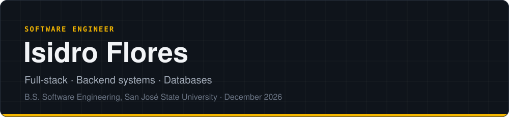
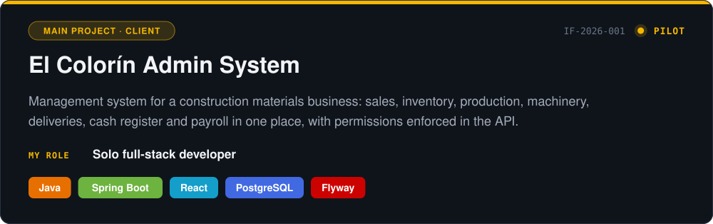
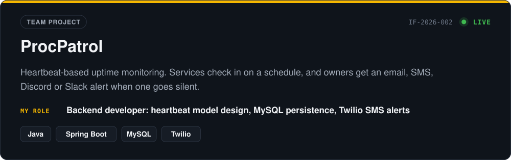
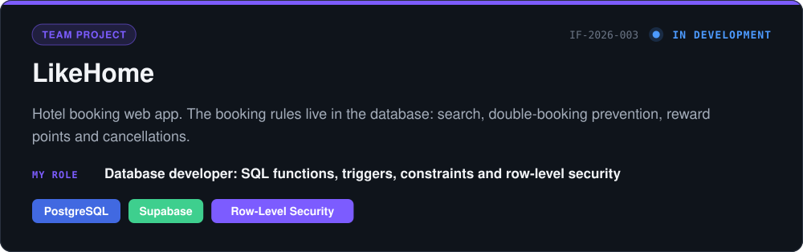
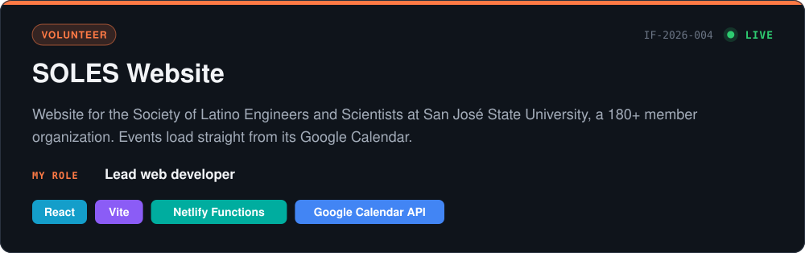
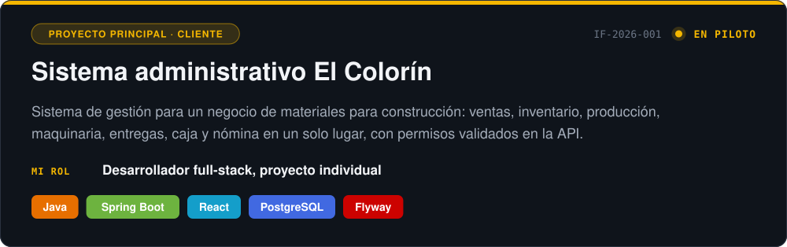
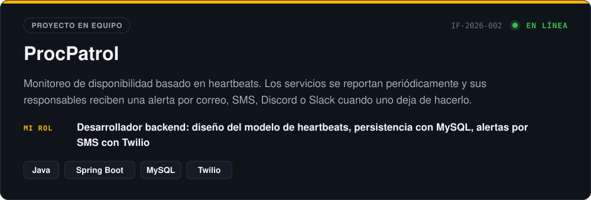
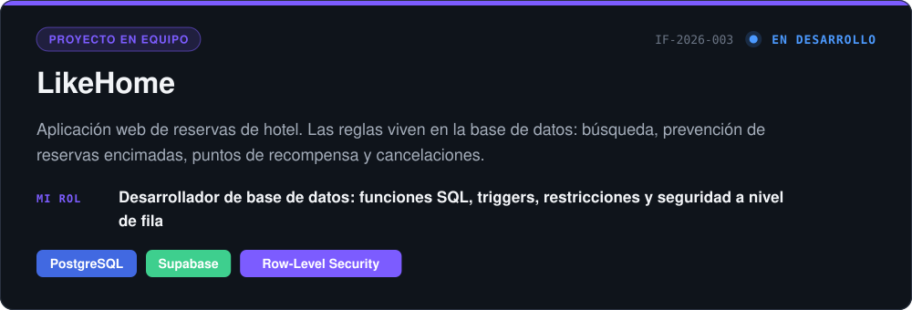
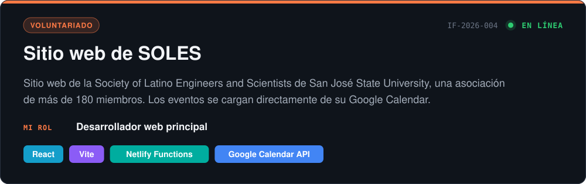

  
  
  

## About

I build web applications end to end, from the database schema and REST API to the interface and deployment. Most of my work is in Java, Spring Boot and PostgreSQL, and I'm currently growing into mobile development.

## Selected work

El Colorín is a private client project; details are available upon request. Screenshots and case studies for every project are on my [portfolio](https://isidrofloresa.github.io/).

## Technologies

**Backend**&ensp;

**Databases**&ensp;

**Frontend**&ensp;

**Deployment and tools**&ensp;

<b>Versión en español</b>

 

## Acerca de mí

Estudiante de Ingeniería de Software en San José State University; me gradúo en diciembre de 2026. Desarrollo aplicaciones web de principio a fin, desde el esquema de la base de datos y la API REST hasta la interfaz y el despliegue. La mayor parte de mi trabajo es con Java, Spring Boot y PostgreSQL, y actualmente me estoy formando en desarrollo móvil. Bilingüe: inglés y español.

## Proyectos destacados

El Colorín es un proyecto privado para un cliente; los detalles están disponibles a solicitud. Las capturas de pantalla y los casos de estudio de todos los proyectos están en mi [portafolio](https://isidrofloresa.github.io/?lang=es).

